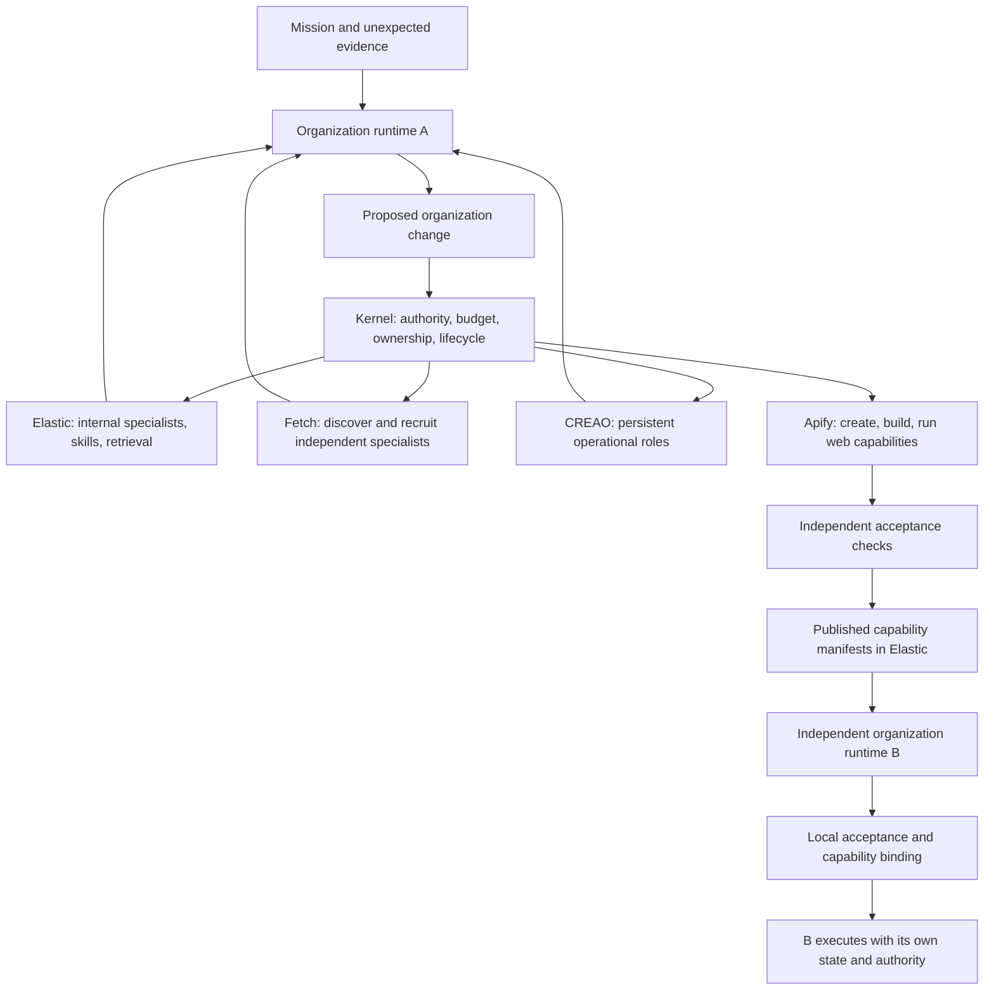

**GENESIS — Research decision: self-expanding organizations**

Research date: October 21, 2026. Direction B is the product: organizations that create, recruit, restructure, and retire roles while acquiring executable capabilities that other organizations can inherit. This report describes a proposed design. Public API documentation was reviewed; authenticated calls, account entitlements, integration latency, and end-to-end execution have not been tested. No application implementation accompanies this report.

**1. Recommendation.** Build a small organization that visibly changes its structure to rescue a disrupted mission, then demonstrate a second independent organization inheriting the resulting capability. Preserve both organizational evolution and capability evolution in the critical path.

The proposed demonstration is an event agency handling a venue cancellation. It creates a relocation lead, recruits an independent logistics specialist, synthesizes a venue-availability Actor, creates a continuing venue-monitor responsibility, and eventually retires its temporary relocation unit. A separate event organization discovers and adopts the capability package with its own mission, state, and acceptance checks.

The central product claim is: **GENESIS changes the organization required to achieve a goal, and preserves useful capabilities beyond the organization that first developed them.** The claim to test is operational, not a claim of first invention.

**2. What counts as organizational evolution.** Roles, agent instances, responsibilities, and tools must be separate objects. A role has an accountable purpose, authority, lifecycle, and relationships. An agent is the provider-backed implementation occupying that role. A responsibility can survive a change of agent or an organizational restructuring.

A new animated node or new prompt is insufficient. A successful mutation must change real task ownership, dispatch eligibility, subscriptions, authority, provider bindings, or reporting relationships. It must cite an observed requirement and preserve the organization's existing commitments. The new role must handle a subsequent event; retirement must stop future dispatch and transfer unfinished obligations.

The mutation vocabulary can be predefined. The role charter, choice of specialist, affected responsibilities, executable implementation, and resulting organization should derive from the mission evidence. Avoid a branch such as `if venue_closed: spawn_relocation_agent()` that already encodes the answer.

Create a role when a requirement introduces continuing ownership, distinct authority or expertise, an independent supplier, or concurrent work. A missing API alone should usually cause a capability addition to an existing role. GENESIS should be able to decide that no additional role is needed.

**3. Minimum architecture.** Implement a small organization kernel whose organization is versioned executable data. The kernel validates agent proposals and reconciles them with actual provider resources. It does not need arbitrary self-modification, a graph database, a decentralized consensus system, or a bespoke foundation model.

The minimal durable model contains missions, requirements, responsibilities, roles, agent bindings, assignments, contractor agreements, capability installations, grants, jobs, and an event log. SQLite is sufficient for the demonstration's authoritative state. Elastic holds searchable projections, evidence, and approved manifests. Search indexing is not the transaction boundary for organizational mutations.

Use separate organization runtimes and state stores for A and B. A shared capability service may manage publishing and execution brokerage. These are application modules, not a requirement for a microservice per sponsor.

The evolution loop is observe → identify gaps → retrieve existing resources → propose mutation → provision and verify → activate → evaluate → retain, revise, or retire. Cross-provider creation is a staged operation: keep a new role non-executable while resources are provisioned; activate ownership only after readiness checks pass. Preserve the old accountable owner until the handoff commits.

**4. Nonduplicative sponsor responsibilities.** GENESIS owns organizational semantics; each sponsor supplies a distinct implementation surface.

| Platform | Responsibility | Evidence in the demo | What breaks if removed |
|---|---|---|---|
| Fetch.ai | Discovery, contracting, and communication with independent specialists | Agentverse search result, independent agent address, offer/accept messages, task result | The organization cannot recruit the external logistics specialist |
| Elastic Agent Builder on Serverless | Internal mission reasoning, dynamically created specialists and skills, retrieval over organization evidence and capability manifests | New Agent Builder agent and skill IDs, native retrieval calls, Org B discovery | Internal specialist creation and evidence-based inheritance fail |
| Apify | Newly synthesized executable web abilities | New Actor ID, source digest, build ID, run ID, dataset, acceptance report | The unfamiliar venue source remains unreadable |
| CREAO | Continuing specialized responsibilities and reusable operational procedures | New agent ID, role instructions, two runs on distinct events, persistent memory | The organization loses ongoing venue monitoring after its temporary team disbands |

Do not wrap the same planner in all four products. Internal Elastic specialists, independent Fetch contractors, and persistent CREAO operators occupy different roles in the organization's graph. Apify Actors are executable capabilities, not additional employees.

**5. Fetch.ai integration contract.** Current official discovery uses `POST https://agentverse.ai/v1/search/agents` with a Bearer Agentverse API key. Request fields include `search_text`, `filters`, `sort`, `direction`, `offset`, and `limit`; filters can restrict active uAgents and protocol compatibility. Returned addresses are candidates, not proof of qualification or agreement. [Agentverse search](https://innovationlab.fetch.ai/resources/docs/agentverse/searching)

Register separately running specialists using the documented `register_chat_agent` helper and `RegistrationRequestCredentials`; keep their processes online. Mailbox operation is supported. Pre-registering contractors before a mission does not weaken runtime recruitment: the discovery, offer, acceptance, and delegation must still happen during the mission. Check search visibility and registration latency during integration. [Registration and local-agent setup](https://innovationlab.fetch.ai/resources/docs/agent-creation/uagent-creation)

Use typed uAgents messages and `ctx.send`. GENESIS defines its own `RecruitRequest`, `Offer`, `ContractAccepted`, `TaskAccepted`, `TaskProgress`, `TaskResult`, and `ReleaseContract` schemas. Both ends must implement the same schema/protocol. Every message carries correlation, task, attempt, contract, and deadline information. Releasing a contract ends this organization's relationship; it must not shut down an independently owned specialist serving other customers. [uAgent communication](https://innovationlab.fetch.ai/resources/docs/agent-communication/uagent-uagent-communication)

**6. Elastic integration contract.** Use an actual Serverless project and its Kibana API URL for Agent Builder, distinct from its Elasticsearch data URL. Agent creation is `POST /api/agent_builder/agents`; management also supports get, update, and delete. A created agent has an ID, name, description, and configuration containing instructions and tool bindings. Current fields also include skills and subagent allowlists. This is real runtime specialist creation. It also means subagent delegation itself is already a platform capability. [Create-agent schema](https://www.elastic.co/docs/api/doc/serverless/operation/operation-post-agent-builder-agents)

Create reusable agent skills with `POST /api/agent_builder/skills`; the documented skill fields include `id`, `name`, `description`, `content`, and `tool_ids`. Agent, skill, and tool lifecycle operations are documented together. Keep GENESIS role IDs independent from provider IDs and retain effective configuration hashes. [API overview](https://www.elastic.co/docs/explore-analyze/ai-features/agent-builder/kibana-api)

Create native retrieval tools with `POST /api/agent_builder/tools`. An `index_search` tool can bind a `configuration.pattern` to an organization-specific index or an approved shared-capability index. Other documented types include ES|QL, workflow, and MCP. Tool patterns do not replace index authorization. [Create-tool schema](https://www.elastic.co/docs/api/doc/serverless/operation/operation-post-agent-builder-tools)

Invoke agents with `POST /api/agent_builder/converse/async`, supplying `agent_id` and `input`, then retain returned conversation identifiers. The endpoint streams SSE events; it is not by its name a durable scheduling service. An experimental task-manager execution option exists, but GENESIS should own the demo's job lifecycle. Separate conversations by role and serialize turns within each conversation. [Streaming converse](https://www.elastic.co/docs/api/doc/serverless/operation/operation-post-agent-builder-converse-async)

Use `Authorization: ApiKey <encoded-key>` and `kbn-xsrf: true` where required. Separate management permissions from ordinary execution and index access. Spaces and index privileges need explicit configuration; naming conventions alone do not isolate organizations. [API-key guidance](https://www.elastic.co/docs/explore-analyze/ai-features/agent-builder/api-keys)

For the MVP, native index-search tools plus schema-validated command envelopes from the agent are sufficient. The kernel executes approved commands and returns results to the next agent turn. External MCP tools are supported, but an exact connector/import configuration must be checked before implementation; do not invent it. [MCP tools](https://www.elastic.co/docs/explore-analyze/ai-features/agent-builder/tools/mcp-tools)

Avoid unattended interactive-approval dependencies. Elastic A2A currently lacks streaming; subagents cannot collect confirmation responses, and A2A runs can remain waiting for an unanswered prompt. Direct converse plus bounded kernel authority is the simpler path. [Known limitations](https://www.elastic.co/docs/explore-analyze/ai-features/agent-builder/limitations-known-issues)

**7. CREAO integration contract.** A public API is available. Select `https://developer.creao.ai/v1` using a server-side `cr_sk_` Account API key. Do not mix it with app-scoped keys or the separately documented hosted `/v2` surface. [API overview](https://docs.creao.ai/developer-api/overview), [authentication](https://docs.creao.ai/developer-api/authentication)

| Operation | Documented path | GENESIS interpretation |
|---|---|---|
| Create a role implementation | `POST /v1/agents` with natural-language `input` | Asynchronous creation; persist returned run ID |
| Poll creation/execution | `GET /v1/runs/{run_id}` | Require terminal success and validate returned result |
| Read/update implementation | `GET` / `PATCH /v1/agents/{agent_id}` | Store effective instructions and configuration digest |
| Execute responsibility | `POST /v1/runs` | Supply agent ID, input, and optional conversation/workspace IDs |
| Install generic bridge skill | `POST /v1/skills` | Account-level skill with supporting HTTP script |
| Read/update role memory | `GET` / `PUT /v1/agents/{agent_id}/memory` | Provider memory complements authoritative kernel state |

Creation can initially return a null agent ID. Poll until an agent ID is supplied at the top level or inside `result`; reject disagreement. A completed run commonly contains `result.text`; this is not a guarantee of schema-constrained business output. Preserve raw provider responses and validate the extracted domain result independently. [Creation](https://docs.creao.ai/developer-api/agents/create-agent), [updates](https://docs.creao.ai/developer-api/agents/update-agent), [runs](https://docs.creao.ai/developer-api/runs/create-async-run), [run status](https://docs.creao.ai/developer-api/runs/get-run-status), [agent memory](https://docs.creao.ai/developer-api/agent-memory)

Use a generic custom skill, installed once, to call the GENESIS capability gateway through a supporting script. The new CREAO role receives its specific charter, capability version, conditions, and reporting procedure in its own instructions. Skill installation supports inline content and supporting files, but sandbox materialization can lag the installation response. A live bridge readiness check is essential. This is a proposed integration built from documented mechanics, not a native CREAO–Apify connector. [Skills API](https://docs.creao.ai/developer-api/skills)

The `/v1` account API manages personal agents and cannot manage native schedules, create team agents, or publish to the Store. Use GENESIS timers to invoke recurring roles. Browser-native schedules have separate plan and interval requirements; they are unnecessary to prove persistent responsibility. [Authentication limits](https://docs.creao.ai/developer-api/authentication), [native schedules](https://docs.creao.ai/features/scheduled-runs)

No public agent-deletion contract was established by this research. Retire through GENESIS: stop timers and dispatch, revoke grants, and hand off obligations. Removing workspace membership does not delete the agent or prevent subsequent direct API execution. [Workspaces](https://docs.creao.ai/developer-api/workspaces)

Account-level secrets are available to every personal-agent run for that account; skills are also account-wide. Workspaces are not a secret-isolation boundary. Use separate accounts for strong tenant separation, or public synthetic demo data with no account-level sensitive secrets and short-lived, gateway-enforced grants. Never place the Apify forge token in CREAO. [Secrets](https://docs.creao.ai/developer-api/secrets)

Default limits include 30 requests per account per minute and 30 management writes per hour; active-run limits depend on the account. Poll through one shared limiter rather than independently per role. If webhooks are used, deduplicate delivery IDs and authenticate a subsequent run-status fetch before accepting results; the reviewed webhook page did not establish an HMAC signature contract. [Rate limits](https://docs.creao.ai/developer-api/rate-limits), [webhooks](https://docs.creao.ai/developer-api/webhooks)

**8. Apify integration contract.** The documented creation path supports source-file Actors. Include the generated extraction module, a pinned build scaffold, and an input schema.

| Step | REST operation |
|---|---|
| Create source-bearing Actor | `POST https://api.apify.com/v2/actors` |
| Create a repaired source version | `POST /v2/actors/{actorId}/versions` |
| Build version | `POST /v2/actors/{actorId}/builds?version=0.0&useCache=true` |
| Poll build | `GET /v2/actor-builds/{buildId}` |
| Validate input | `POST /v2/actors/{actorId}/validate-input?build=<build-number>` |
| Execute pinned build | `POST /v2/actors/{actorId}/runs?build=<build-number>` |
| Poll execution | `GET /v2/actor-runs/{runId}` |
| Retrieve output | `GET /v2/datasets/{defaultDatasetId}/items?format=json` |

The creation payload supports a versions array with `versionNumber`, `sourceType: SOURCE_FILES`, and `sourceFiles` containing text files. Store the Actor ID, build ID, exact build number, source digest, run ID, and output dataset ID. Do not execute `latest` when claiming to use a verified artifact. [Create Actor](https://docs.apify.com/api/v2/actors-post), [source versions](https://docs.apify.com/api/v2/actor-versions-post), [build API](https://docs.apify.com/api/v2/actors-builds-post), [run API](https://docs.apify.com/api/v2/actors-runs-post), [dataset items](https://docs.apify.com/api/v2/dataset-items-get)

Input-schema validation establishes input shape, not correctness of extraction or mission success. An Actor without an input schema does not gain semantic checking by calling the validation endpoint. Verify outputs against held-out fixture truth and business invariants. [Actor definition](https://docs.apify.com/actors/development/actor-definition/actor-json), [input validation](https://docs.apify.com/api/v2/actor-validate-input-post)

Scoped Apify API tokens cannot create or modify Actors. Keep the necessary unscoped forge token exclusively in the trusted backend. Request `forcePermissionLevel=LIMITED_PERMISSIONS` for generated Actor runs and use explicit runtime, memory, and cost limits. Limited Actor permissions are not a complete arbitrary-code security boundary or outbound network allowlist; they still permit some Apify resource access. Public synthetic input data and no sensitive runtime credentials are the appropriate demo boundary. [API scopes](https://docs.apify.com/integrations/api), [Actor permissions](https://docs.apify.com/actors/development/permissions)

Cold build latency is not guaranteed to fit a three-minute presentation. Builds default to a 1,800-second timeout, and caches are best effort. `waitForFinish` up to 60 seconds describes HTTP waiting, not a completion guarantee. Generate a narrow parser in a stable scaffold, minimize dependencies, and measure actual timings. [Build behavior](https://docs.apify.com/actors/development/builds-and-runs/builds)

**9. Competitive and research challenge.** The following are close precedents, not assertions that a product cannot support additional functionality. Benchmark research and vendor documentation do not establish production reliability across independent organizations.

| Prior art | What is already demonstrated or documented | What GENESIS must additionally prove |
|---|---|---|
| [AG2 CaptainAgent](https://classic.docs.ag2.ai/latest/docs/user-guide/reference-agents/captainagent/) and [dynamic agents](https://docs.ag2.ai/docs/user-guide/subagents/) | Expert-team construction, agent generation/retrieval, tool assignment, runtime subagents | Durable ownership changes and inherited executable capability |
| [AgentVerse research](https://arxiv.org/abs/2308.10848) | Recruitment, collaborative decisions, execution, evaluation, changing team composition | Persistent institutions and capability transfer; distinct from Fetch Agentverse |
| [AutoAgents](https://github.com/link-agi/autoagents) | Generated roles/plans, observers, reusable agents | New executable abilities plus organizational continuity |
| [MegaAgent](https://github.com/Xtra-Computing/MegaAgent) | Dynamic hierarchy, task decomposition, parallel workers, monitoring | Evidence-gated capability birth and transfer across separate organizations |
| [DyLAN](https://github.com/SALT-NLP/DyLAN) | Task-specific team optimization and dynamic networks | Continuing obligations, authority, and capability growth |
| [ADAS](https://github.com/ShengranHu/ADAS) / [AFlow](https://arxiv.org/abs/2410.10762) | Search over agent designs/workflows using feedback | Changes during a live mission without losing existing commitments |
| [EvoMAS](https://github.com/amazon-science/EvoMAS) | Evolution of structured multi-agent configurations | Online operating responsibility and external capability inheritance |
| [EvoAgent, April 2026](https://arxiv.org/html/2604.20133v1) | Hierarchical delegation and multi-file skill evolution; paper describes offline evolution and lack of cross-user sharing | Live combined evolution and independent organization adoption |
| [CORAL](https://human-agent-society.github.io/CORAL/) | Isolated agents, lifecycle management, shared skills, separate evaluation, long-running evolution | Operational missions, external recruitment, authority and local adoption |
| [Alita-G](https://arxiv.org/abs/2510.23601) | Synthesized, generalized, retrievable MCP tools | Persistent organizational restructuring around those abilities |

The new [AGORA preprint](https://arxiv.org/abs/2610.19799), submitted October 14, 2026, studies how team arrangements and authority affect self-evolution. It reports that evolution alone rarely helps in its evaluated settings. Treat this as emerging evidence, not a general law. It supports testing contraction and authority transfer rather than equating more agents with progress.

Avoid claiming that existing systems all have fixed teams, that generated MCP tools are new, or that two agents using one tool prove a network effect. GENESIS's differentiating target is the complete causal chain: requirement → responsibility/structure mutation → executable capability birth → independent verification → local adoption by another organization.

**10. Primary mission and demonstration.** The mission is to operate a simulated campus event for 120 attendees within a budget and time window. Initial roles own mission coordination, program planning, and attendee information. A new venue closure requires a continuing relocation and logistics responsibility while the original program work continues.

The unfamiliar venue portal is a clearly labeled test environment with real HTML and independently stored canonical fixture data. The judge can vary capacity, date, availability, price, and page layout without specifying the role or code to create. Generated code, provider agent creation, cloud Actor build/run, Fetch communication, and cross-organization discovery are real. Venue reservations and physical logistics remain simulated.

The initial system does not contain the generated parser, relocation specialist definition, or a hardcoded role-creation branch. It may contain a generic Actor scaffold, an organization-mutation vocabulary, standing verification rules, and preregistered external specialists. A second withheld disruption, such as a venue capacity reduction, checks that the response depends on evidence rather than a single scripted trigger.

| Presentation time | What the judge sees |
|---|---|
| 0:00–0:20 | Goal, starting organization, owners, budget, and event plan |
| 0:20–0:40 | Closure evidence; separate organizational and capability gaps |
| 0:40–1:15 | Elastic creates relocation lead; Fetch specialist accepts delegation; Apify build progresses |
| 1:15–1:45 | Held-out checks pass; new capability used to update feasible plan; actual IDs and receipts available |
| 1:45–2:10 | CREAO continuing monitor runs; a second availability change is handled using the new responsibility |
| 2:10–2:40 | Org B discovers manifest, performs local acceptance, instantiates its own role and runs same pinned artifact on different input |
| 2:40–3:00 | Temporary role retires after handoff; new operating responsibility and shared capability remain |

These times are a presentation target, not measured latency. Start independent provisioning work concurrently. If measured cold creation cannot finish inside the slot, show the real asynchronous creation live and a clearly identified recording of a full completed run. Do not present a prebuilt artifact as freshly generated. A fast-path replay demonstrates execution and inheritance, not live cold synthesis; say which path is shown.

Keep three synchronized views: mission results, responsibility/organization changes, and provider evidence. A second run, changed owner, grant revocation, and Org B's zero new synthesis calls convey more than a large animated graph.

**11. Inheritance contract.** Publish a versioned package containing its intent, applicability limits, role/responsibility template, workflow procedure, exact executable reference, input/output contracts, permission requirements, local configuration requirements, acceptance suite, verification evidence, provenance, and known failures. Publishing is an explicit approved scope, not automatic release of every trace.

Org B searches by its own need, selects compatible evidence, installs local bindings, runs local acceptance tests, and creates its own responsibility/role. It must not receive Org A's conversation, internal provider connector IDs, secrets, or private mission data. Log that source-code synthesis was not invoked for B. B's success must concern different input and its own mission criteria.

Two separate runtimes with public synthetic data demonstrate organizational independence. They do not prove production tenant isolation. Shared Apify Actor storage and CREAO account-level secrets require stronger production separation. A manifest's passing fixture report must always state scope; it is not universal verification.

**12. What fits in 36–48 hours.** Estimates assume a four-person team and usable sponsor accounts. The first milestone is API proof, not UI polish.

| Time | Deliverable |
|---|---|
| Hours 0–4 | Live create/invoke checks for Elastic and CREAO; Fetch search and typed round trip; minimal Apify create/build/run; verify CREAO HTTP bridge and measure latency |
| Hours 4–12 | Kernel state model, durable jobs/outbox, provider adapters, public fixture portal, independent oracle |
| Hours 12–24 | First complete Org A mutation and role/tool creation; native retrieval; fixed verification gate |
| Hours 24–34 | CREAO second run, responsibility handoff/retirement, separate Org B discovery/installation/execution |
| Hours 34–42 | UI tied to real events, failure cases, duplicate/retry tests, two withheld fixtures |
| Hours 42–48 | Rehearsals, latency/cost recording, honest recording fallback, submission evidence |

Parallel ownership: one person kernel/Elastic, one Fetch/contracts, one Apify/verification, one CREAO/UI. Integrate against shared schemas early. With fewer people, reduce visual breadth and optional repair, not the two evolution loops or the second organization.

Essential scope: one complete organization mutation, one external recruitment, one new Actor, one verification gate, one continuing CREAO role with two runs, one inheritance event, and one retirement with handoff. Stretch: one bounded repair after layout drift. Defer payments, public marketplaces, arbitrary recursive spawning, automatic multi-tenant publication, general browser credentials, and open-ended self-editing of the kernel.

**13. Acceptance and falsification.** Require new real provider IDs, absence of the role/artifact before the trigger, evidence-cited ownership changes, held-out extraction correctness, a later event handled by the new role, no post-retirement dispatch, and independent Org B execution. Record complete run duration, provider times, total observed cost, human interventions, synthesis attempts, rejected candidates, and local adoption results. Do not invent performance claims before measuring them.

Run an ablation with organizational mutation disabled, then another with the new capability unavailable. Compare against a strong generalist using the same tools and approximate resource budget. A blocked initial organization shows a new ability was acquired; it does not alone prove multi-agent organization is superior. Evaluate that separately using missed obligations, intervention effort, correctness, and cost.

**14. Principal failure modes.**

| Risk | Consequence | Design response |
|---|---|---|
| Organization changes are cosmetic | Demo is ordinary orchestration | Verify ownership, authority, future dispatch and handoff |
| Unnecessary role proliferation | More cost and coordination errors | Require a continuing responsibility or distinct boundary; support reuse and retirement |
| Model writes both answer and oracle | Incorrect capability appears verified | Fixed domain invariants and held-out canonical fixture truth |
| Provider creation is slow | Three-minute cold path misses deadline | Measure early; parallelize; clearly label recorded full-run fallback |
| CREAO run completes without intended write | False mission success | Validate domain state independently; keep commits kernel-controlled |
| Resource provisioning partially succeeds | Ghost roles and orphaned jobs | Persist provisioning saga; activate only when ready |
| Duplicate or late results | Repeated effects or resurrected roles | Attempt IDs, idempotent effects, assignment/lease fencing |
| Private context leaks through sharing | Invalid independence/privacy claim | Explicit publication bundle; separate secrets and local acceptance |
| Repair works for A but breaks B | Correlated network failure | Immutable versions, local adoption, rollback; no automatic global promotion |
| Sponsor APIs duplicate control logic | Fragile wrappers with little value | One organizational authority in GENESIS; clear provider responsibilities |

**15. Event and sponsor requirements.** The official event page names Application, Intentionality, Functionality, Creativity, and Technical Complexity. It specifies a three-minute pitch, two-minute Q&A, a locally stored recorded demo, and work during the hackathon. Elastic's listed award explicitly requires Agent Builder on Serverless. Fetch lists Best Use; Apify lists Best Use and Best Actor; CREAO lists AI-First Disruptor, One-Person Company, and Team Empowerment. Detailed sponsor eligibility beyond those descriptions was not established; confirm onsite. [Official Cal Hacks 13.0 listing](https://cal-hacks-13-0.devpost.com/)

GENESIS's evidence should support each sponsor's actual function. Using Elasticsearch alone does not demonstrate Agent Builder. Calling a fixed scraper does not demonstrate Actor creation. Listing an address does not demonstrate recruitment. A CREAO screenshot without an executed persistent responsibility is decorative.

**16. Long-term architecture.** Grow from one complete cycle into a network of organizations with durable constitutions, mutable responsibility graphs, specialist contracts, reusable organizational designs, and capability packages carrying evidence and adaptation requirements. Organizations can split a department, consolidate redundant roles, replace an ineffective specialist, establish a recurring function, and retain expertise when temporary teams disband.

The network should share generalized capability packages and, where authorized, organizational patterns. A recipient instantiates its own roles and policies rather than copying another organization's authority. Reputation should be conditional on task class and environment; a published repair is a candidate update rather than an automatic network-wide rollout.

Eventually GENESIS could support organizations recruiting services from one another, forming temporary joint teams, and inheriting successful operating structures. The hard research problems are evaluating organizational changes, preventing negative transfer, preserving privacy and ownership, and measuring whether cross-organization experience reduces future adaptation effort. None is solved by making the registry larger.

**Pitch.** “GENESIS creates the organization a mission needs. When the mission changes, it recruits specialists, invents missing capabilities, and restructures responsibility. What one organization learns can become a verified ability another organization inherits.”

The smallest convincing proof is one complete organizational life cycle: a requirement creates a new function, the function gains an executable ability, another organization adopts it, and the temporary team can disappear without losing the useful capability.
