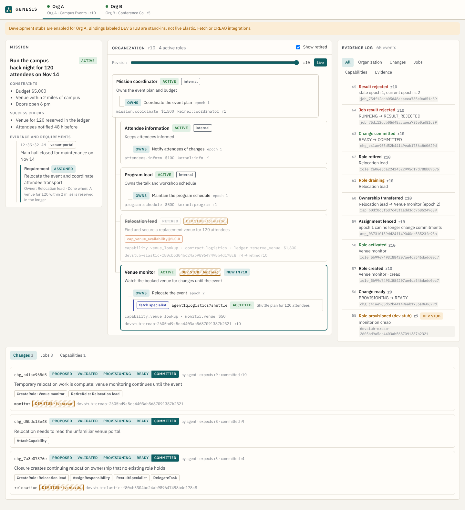

# Developing the kernel and console

This covers the Rust organization kernel (`crates/`) and the React console (`apps/web/`). Provider integrations have their own guides; the table below says which are tested only against fakes.



## Run it

You need Rust 1.80+ and Node 20+.

```bash
# Terminal 1: registry (7100) + Org A (7101) + Org B (7102), with dev stubs
cargo run -p genesis-server -- dev

# Terminal 2: the console on http://127.0.0.1:5173
cd apps/web && npm install && npm run dev

# Terminal 3 (optional): drive the full A -> B cycle against the dev stubs
node scripts/dev-scenario.mjs --delay 1200
```

State lives in `data/dev/*.db` (git-ignored). Delete that folder for a clean run.

## Integration status

| Integration | Guide | Status |
| --- | --- | --- |
| Elastic: evidence projection/search, capability search, Agent Builder specialists and jobs | [ELASTIC.md](ELASTIC.md), keys: [ELASTIC_SETUP.md](ELASTIC_SETUP.md) | Merged (#11); fake-tested. Run `genesis-elastic-smoke` against a real project |
| Mission planner (any LLM, or an Elastic Agent Builder agent) | [PLANNER.md](PLANNER.md) | Merged (#12, #22); replay- and fake-tested; model not chosen |
| CREAO asynchronous roles and jobs | [CREAO_RUNTIME.md](CREAO_RUNTIME.md), [ASYNC_PROVISIONING.md](ASYNC_PROVISIONING.md) | Kernel hook and env registration merged (#20). Gateway readiness (#26), operator attach (#27) and the CREAO readiness probe (#29) are open. Scripted-provider tests only; no live run |
| Apify capability acquisition, execution, acceptance and adoption | [CAPABILITY_EXECUTION.md](CAPABILITY_EXECUTION.md) | Merged; loopback-fixture tested |
| Fetch recruitment | [FETCH_RUNTIME.md](FETCH_RUNTIME.md) | Local multi-process proof |
| Console: capability evidence (#21), Attention panel and failure drills (#28) | open PRs | Dev stack |

None of these have been run against live sponsor accounts yet. `genesis dev`
uses labeled development stubs for every provider. Review status of open PRs:
[PR_REVIEW_QUEUE.md](PR_REVIEW_QUEUE.md).

**Dev stubs are not integrations.** With stubs on, any role whose provider has no adapter gets a binding with `provider: "dev_stub"` and an ID like `devstub-elastic-…`. The console labels these `DEV STUB · for elastic`, and the `role_provisioned` event carries `dev_stub: true`. Run an organization without `--dev-stub` and unconfigured providers fail provisioning instead.

## Tests

```bash
cargo test --workspace          # engine invariants, store, HTTP end-to-end, provider fakes
cargo clippy --workspace --all-targets
cd apps/web && npm test && npm run build
```

The HTTP tests in `crates/genesis-server/tests/api.rs` start a real registry and separate organization servers on random ports. They cover the saga, failed provisioning, revision conflicts, stale-epoch fencing, idempotent results, the publication bar, A → B inheritance with zero synthesis, an isolation canary, incompatible adoption, SSE replay and restart from SQLite.

## Layout

| Path | What it is |
|---|---|
| `crates/genesis-core` | Pure domain: IDs, lifecycle tables, `OrgState`, change vocabulary, `engine` (validate/commit/dispatch/fencing), capability manifests, events. No I/O. |
| `crates/genesis-providers` | `RoleProvisioner` and `CapabilityExecutor` traits, `DevStub`, `FailingProvisioner`, `ProviderSet`. |
| `crates/genesis-server` | Axum API, SQLite store, change saga, outbox worker, SSE, shared registry, `genesis` CLI. |
| `schemas/` | JSON Schemas exported from the Rust types. A test fails if they drift. |
| `apps/web` | Console. `src/lib/contracts.ts` is generated from `schemas/`. |
| `scripts/dev-scenario.mjs` | Dev-only driver for the demo cycle. |

## How a change flows

1. An agent posts `POST /api/v1/org-changes` with `client_request_id` and a proposal citing observation IDs and `expected_org_revision`.
2. The kernel validates it against current state (`genesis_core::engine::validate`). Invalid proposals are stored as `REJECTED` with error codes; a stale revision returns 409.
3. Valid changes go `VALIDATED → PROVISIONING`. For each `CreateRole`, the saga calls the provider's `RoleProvisioner`, checks readiness, and persists the returned binding on the change record before moving on. A restart resumes from there.
4. `READY → COMMITTED` happens in one SQLite transaction: new snapshot at revision + 1, events, and outbox items for the newly responsible roles. New roles are never visible as active before this.
5. Any provisioning failure ends in `FAILED` and leaves the organization untouched.

## Contracts for other workstreams

Regenerate after changing any Rust type that crosses a boundary:

```bash
cargo run -p genesis-server -- export-schemas
cd apps/web && npm run gen:types
```

| Who | Calls | Token |
|---|---|---|
| Elastic mission agent | `POST /missions/{id}/observations`, `POST /missions/{id}/requirements`, `POST /org-changes`, `GET /organization` | agent |
| Elastic / CREAO / Fetch adapters | implement `RoleProvisioner`; report `POST /jobs/{id}/results` | adapter |
| Fetch bridge | `POST /contracts/{id}/state` with `sender_address` (must match the contracted specialist) | adapter |
| Apify verifier | build a `CapabilityManifest` with a `VerificationReport` (2 success cases + 1 unsupported, all passing); the operator publishes via `POST /capabilities/publish` | operator |
| Org B | `POST /capabilities/search`, `POST /capability-installations`, `POST /capability-installations/{id}/acceptance`, `POST /capability-runs` | operator |

Job results must carry the job's `attempt_id` and `epoch`. A result with an old epoch is archived as `RESULT_REJECTED` (409 `stale_epoch`). Provider success with `domain_verified: false` leaves the job in `VERIFYING`. Repeating a result with the same `operation_id` produces one ledger row.

### Plugging in a real adapter

```rust
let providers = ProviderSet::new()
    .with_provisioner(Provider::Elastic, Arc::new(ElasticAdapter::new(cfg)))
    .with_dev_stub(DevStub::default()); // optional fallback for the rest
let app = genesis_server::build_org(&org_config, Some(providers))?;
```

## Known gaps

- Registry search is keyword ranking. The Elastic workstream should replace it with native retrieval over the same manifests.
- Outbox items for providers without an adapter stay pending with `last_error` (visible at `GET /api/v1/outbox`) unless dev stubs are on.
- Capability runs submit directly to the executor after the job is persisted; results come back through `/jobs/{id}/results` like any other job.
- Tokens are static bearer strings from env vars. Fine for the demo, not for production.
- SQLite access is serialized behind one mutex per organization. Fine at demo scale.
