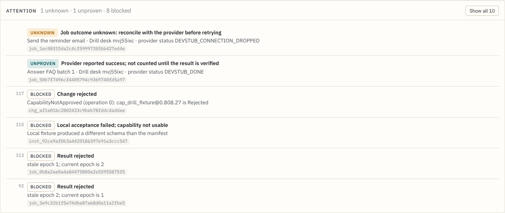

# Failure drills and the Attention panel

GENESIS is meant to refuse unsafe changes and to keep uncertain outcomes
visible instead of guessing. Two pieces make that easy to show and to check.

## Attention panel (console)

`apps/web/src/components/AttentionPanel.tsx`, computed by
`apps/web/src/lib/attention.ts` from persisted change records, jobs and the
event log only. It sits above the other panels and is hidden when there is
nothing to show.

| Label | Meaning | Source |
| --- | --- | --- |
| NEEDS YOU | A provider creation outcome is unknown (`needs_reconciliation`). The item has an inline form: **Attach agent** (the agent ID found in the provider account, plus a recorded reason) or **Abandon…** (asks for confirmation; fails the change and keeps provider IDs). | `OrgChangeRecord.operations` of PROVISIONING changes |
| UNKNOWN | A job's outcome is unknown; reconcile with the provider before retrying. | jobs in `UNKNOWN` |
| UNPROVEN | Progressing but not proven: a created (or operator-attached) agent waiting for readiness evidence, a provider operation retrying, or provider success awaiting domain verification. | operations, jobs in `VERIFYING` |
| BLOCKED | The kernel refused a request: rejected change, rejected (stale or fenced) result, failed local acceptance. | events |
| FAILED | A change or job ended FAILED; provider agent IDs kept for cleanup are listed. | events |

Open items come first, then the most recent history; **Show all** lists
everything. Attach and abandon call the operator routes described in
[ASYNC_PROVISIONING.md](ASYNC_PROVISIONING.md); attaching never re-creates
the agent, and the role still activates only after readiness is proven.
A pending role's card marks an operator-attached agent ("attached by
operator") and shows readiness evidence once it exists
(`readiness gateway-receipt:…`, see [GATEWAY_READINESS.md](GATEWAY_READINESS.md)).



The screenshot is from the local dev stack after `dev-scenario.mjs` and
`dev-failures.mjs`: all provider bindings there are development stubs.

## Failure drills (dev stack only)

```
cargo run -p genesis-server -- dev
node scripts/dev-failures.mjs            # optional: after scripts/dev-scenario.mjs
```

The script refuses to run against a kernel without development stubs. It
creates a small mission (two roles) in Org A, sends requests that a safe kernel
must refuse or hold back, checks each response, and exits 1 if any expectation
fails, so it doubles as a smoke test. Each refusal is a real kernel decision;
the actors are simulated with the dev tokens. Refused changes, results and
acceptance are recorded in the event log and appear in the Attention panel.
Drills 5 and 6 are refused at the route (`403`) before anything is recorded,
so they appear only in the script's output.

| # | Drill | Expected |
| --- | --- | --- |
| 2 | Proposal based on an old revision | `409 revision_conflict` |
| 3 | New role with a scope outside the constitution | `422 missing_authority` |
| 4 | Retire a role that still owns work, without handoff | `422 validation_failed` (`retirement_drops_obligations`) |
| 5 | Agent token dispatching a job | `403 missing_authority` |
| 6 | Job requiring a scope the role lacks | `403 missing_authority` |
| 7 | Provider success without domain verification | `202`, job `VERIFYING`, no ledger row |
| 8 | Result for the wrong epoch | `409 stale_epoch`, job `RESULT_REJECTED` |
| 9 | Same result delivered twice | second reply `duplicate: true`, one ledger row |
| 10 | Provider outcome unknown | `202`, job `UNKNOWN` |
| 11 | Late result after the responsibility was handed off | `409 stale_epoch` (or `result_fenced`), no ledger row |
| 12 | Attach a capability that failed local acceptance | installation `REJECTED`, then `422 incompatible_capability` |

Each run adds two roles; the demo constitution allows ten active roles, so
restart the dev stack with a fresh data directory after a few runs.

The asynchronous provider path (pending creation, lost outcome, gateway
readiness) does not run in the dev stack, which has no asynchronous
provider. It is covered by `crates/genesis-server/tests/gateway_readiness.rs`
and `tests/operation_attach.rs`; the NEEDS YOU form appears once a real
provider operation needs reconciliation.
