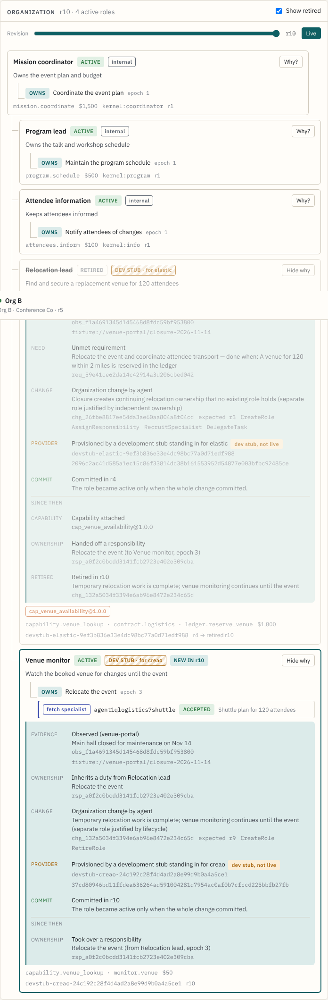

# Role provenance: "Why does this role exist?"

Each role card in the console has a **Why?** button. It opens the role's
evidence chain, rebuilt in the browser from records the kernel already
persists. The chain cites the identifiers it came from and never guesses.

| Step | Source |
| --- | --- |
| Evidence | `proposal.trigger_evidence_ids` → `state.observations` (source, summary, `evidence_ref`) |
| Need | `AssignResponsibility { target: from_requirement, owner: new key }` → `state.requirements` (summary, acceptance) |
| Inherits a duty | `RetireRole.handoffs` or `ReassignResponsibility` aimed at the new key |
| Planner | `planner_decision` event with the same `change_id` (model, summary, rationale, attempt, latency) |
| Change | the committed change: submitter, rationale, `CreateRole.justification`, operations |
| Provider | `change.provisioned[key]` and `change.operations[key]` |
| Ready | `operations[key].readiness_evidence` |
| Commit | `committed_revision` |
| Since then | `responsibility_transferred`, `capability_attached` and `role_retired` events, with the retiring change's rationale |

Bootstrap roles are attributed to the mission whose responsibilities they own.

## Honesty rules

- A DevStub binding is labeled "development stub standing in for *provider*"
  and tagged **dev stub, not live**.
- An operator-attached agent ID is shown as "attached by an operator", in the
  warning tone. It is never presented as an agent the provider created.
- The planner step appears only when a `planner_decision` event names the
  change. A change submitted by hand or by the scripted scenario has no
  planner step.
- If nothing explains a role, the drawer says so.
- The drawer is shown only in live view. Historical revisions hide it, because
  the change and event records are current, not as of that revision.

Code: `apps/web/src/lib/provenance.ts` (pure, tested in `provenance.test.ts`)
and `components/WhyDrawer.tsx`. There are no API or schema changes.
